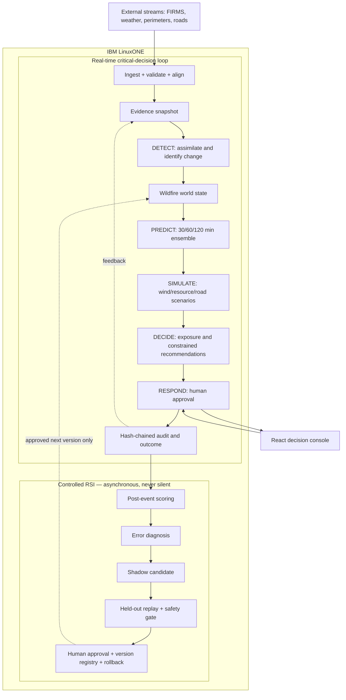

# CityShield architecture

CityShield preserves the reusable flow of `cityos-flood` while replacing flood-specific dynamics and actions with wildfire state, spread, exposure, evacuation and resource decisions.

The real-time and RSI paths are deliberately separated. Detect/Decide/Respond stays deterministic for a frozen evidence snapshot; RSI only consumes completed-event outcomes and may propose a versioned shadow candidate.

## World-model contract

- **World:** city cells, adjacency, fuel, terrain, weather, roads, population and facilities.
- **State:** burning probability, intensity, remaining fuel and uncertainty by cell.
- **Action:** advisory evacuation preparation, route review and resource staging.
- **Cost:** exposed population/facilities, route loss, uncertainty and resource constraints.
- **Safety:** no automatic public warning, evacuation order or dispatch; human review is mandatory.

## LinuxONE boundary

The API, stream/replay processor, state estimator, ensemble forecast, decision engine, controlled RSI and audit log run inside the LinuxONE deployment boundary. External public data providers remain outside it. The web console can be served separately or from the same platform.

## Identity chain

`evidence_snapshot_id → forecast_run_id → simulation_run_id → decision_run_id → audit hash`

Every recommendation can therefore be traced to a frozen set of observations, model/config version, scenario and human review. A duplicate observation is ignored by its provider identity rather than silently changing the state twice.

## Remaining city-specific boundary

The platform is complete up to the spatial adapter. Selecting a city must provide its boundary, cell geometry, local projection, authoritative road/evacuation layers, critical facilities and at least one historical incident. Those inputs may change the calibrated model and decisions, but not the contracts above.

